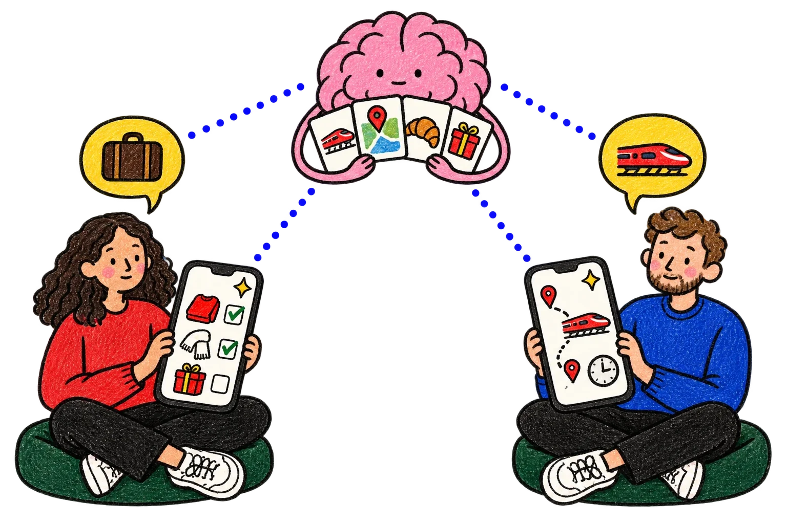
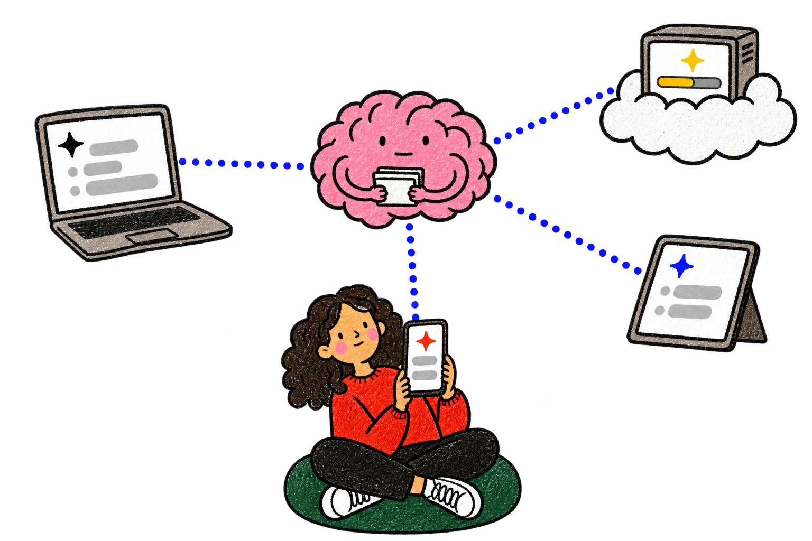

<p align="center">
  <a href="https://par.works"></a>
</p>

<h1 align="center">An operating system for your AIs.</h1>

<p align="center">
  Give them shared memory, files and a home for all the apps they build for you.
</p>

<p align="center">
  <a href="https://par.works/get-started"><strong>Get started →</strong></a> ·
  <a href="https://par.works/how-it-works">How it works</a> ·
  <a href="https://par.works/apps">Explore the possibilities</a>
</p>

<p align="center">
  <a href="https://par.works"></a>
</p>

<p align="center"><em>One trip. One shared Par. Her packing list. His train plan.</em></p>

## Apps used to start empty. Yours start with your life in them.

Tell your AI what you need. Par gives it your notes, decisions and files to work with, and a place for the app it builds. Open the app on your phone, use it with your people, and ask for changes when life changes.

These are apps **you ask your AI to make**, shaped around your life:

> “Quiz me in French on my own week.”
>
> “Save Grandma's soup for all of us.”
>
> “A game for tonight, for the three of us.”

<p align="center">
  <a href="https://par.works/apps"></a>
</p>

Your family cookbook. A launch tracker for your team. A game for your friends. The app lives at Par, ready to use on your phone and computer. Apps that use the same records can work together: add a flight in one, and your packing list can use it too.

## Change the AI. Keep your Par.

Save a decision in one conversation. Find it in the next. Connect another AI, and it can work with that same memory, those same files and those same apps.

<p align="center">
  <a href="https://par.works/how-it-works"></a>
</p>

Use the AI you already like. Par connects through MCP, so compatible clients can read and update the workspace you authorize. You choose which workspace to connect and can revoke that connection in Par.

## Make your first app

1. **[Create your Par or sign in](https://par.works/get-started).**
2. **Connect your AI.** Follow the setup on that page, or add the remote MCP server `https://par.works/mcp` in a client that supports MCP and OAuth. Sign in and choose your workspace.
3. **Ask for one app you need this week.** Try the request below, then open the link your AI gives you on your phone.

```text
Make me an app in Par to track the three things I want to finish this week.
Each task needs a title and a done checkbox. Give me the link so I can
use it on my phone, and save changes when I check something off.
```

You can connect to Par before this plugin is listed in a marketplace.

<details>
<summary><strong>Connecting from Cursor</strong></summary>

Add Par as a remote MCP server using Cursor's [MCP setup](https://cursor.com/docs/mcp). In a client configuration that uses `mcpServers`, the connection is:

```json
{
  "mcpServers": {
    "par": {
      "url": "https://par.works/mcp"
    }
  }
}
```

Complete the OAuth sign-in and choose the workspace. No API key or local Par server is needed.

To try this entire plugin, including both skills, follow Cursor's [local plugin instructions](https://cursor.com/docs/plugins#test-plugins-locally): place this repository in `~/.cursor/plugins/local/par`, reload Cursor, and check its components in Customize. Local imports must be enabled by your team's policy.

</details>

## What's in this plugin?

| Included | What it helps you do |
| --- | --- |
| **[Par MCP connection](mcp.json)** | Connect your AI to your Par workspace: memory, files and apps. |
| **[act-as-par](skills/act-as-par/SKILL.md)** | Find saved context, preserve useful knowledge and reuse your workspace's methods. |
| **[morning-edition](skills/morning-edition/SKILL.md)** | Ask for a morning edition drawn from your workspace, with its own live Par app. |

The morning edition runs when you ask, or through a schedule you have already configured and authorized in your AI app. The skill does not install a scheduler or turn on Par's own AI.

This repository is the portable [Agent Plugins](https://agent-plugins.org/) package for the hosted Par service. The plugin is MIT-licensed; Par accounts and plans are described on the [website](https://par.works/pricing).

<details>
<summary>Release and marketplace status</summary>

Version `2.0.0-rc.1` is a public release candidate. The Cursor application was submitted on 5 November 2026 and is awaiting review. A public repository is not a marketplace approval.

</details>

---

<p align="center"><strong>What will yours be?</strong></p>
<p align="center"><a href="https://par.works/get-started"><strong>Connect your AI and make something for your life →</strong></a></p>

<p align="center">
  <a href="https://par.works">Website</a> ·
  <a href="https://par.works/support">Support</a> ·
  <a href="https://par.works/privacy">Privacy</a> ·
  <a href="https://par.works/terms">Terms</a> ·
  <a href="LICENSE">License</a>
</p>

<p align="center"><sub>Illustrations and product stories from <a href="https://par.works">par.works</a>.</sub></p>
